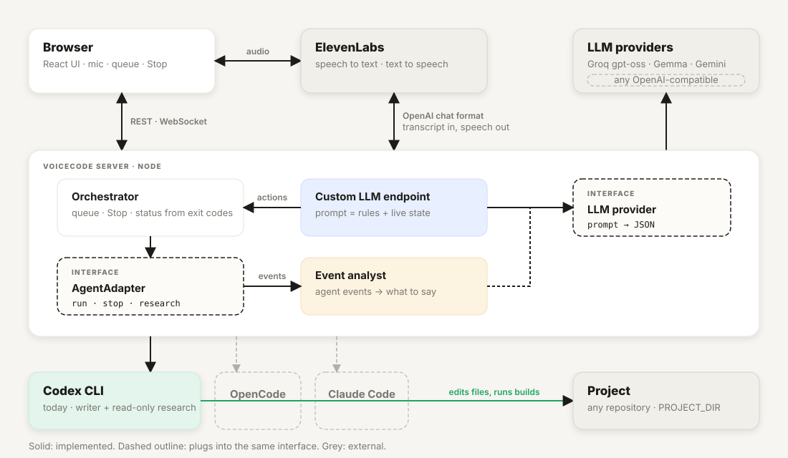

# VoiceCode

**Bring your own coding agent. Give it a voice.**

VoiceCode is a voice interface for coding agents. You describe a change over a headset, a coding agent applies it to a real project, and VoiceCode tells you what happened in the words an engineer would use: which files changed, which command ran, what the exit code was. Built in one hackathon day on Codex CLI, ElevenLabs and open models.

## The idea

Coding agents do the work well. What still costs attention is everything around them: writing prompts, watching a terminal, scanning output to learn whether anything actually happened. VoiceCode takes that part off the screen.

- **Speak the task.** A sentence like "add tags to tasks, show them as chips, let me filter by tag" becomes a precise instruction for the agent and an entry in a visible queue.
- **Hear the work, not the noise.** Every agent event is reviewed before it is spoken. Routine steps are skipped; the plan, file edits, failures and the result are narrated with file names, commands and exit codes.
- **Trust what you hear.** The status of a task comes from exit codes, not from the model. "Build passed" is only said when a build command exited with 0.
- **Ask without interrupting.** A question about the codebase runs in a separate read-only agent while the coding task continues.
- **Stop is a button, not a request.** It goes straight to the server, kills the agent's process tree, pauses the queue and keeps pending work. Resume is explicit.
- **Nothing is tied to one vendor.** The voice platform, the language model and the coding agent each sit behind a small interface. Codex, Groq and ElevenLabs are today's choices, not assumptions.

## A session

| You say | What happens |
|---|---|
| "What are you working on?" | Reads the live state. "Nothing is running, the queue is empty." |
| "Add tags to tasks, show them as chips, filter by tag, make sure the build passes." | Task queued and started. You hear the plan: *"I'll add a tags field to each task and render them as chips beneath the title."* |
| "By the way, how are tasks stored?" | A read-only research run answers in about 15 seconds while the coding run continues. |
| "Next, add due dates and highlight overdue tasks." | Queued behind the active task. |
| *(silence)* | *"Tags are done. Changes in src/App.tsx and src/App.css, npm run build exited 0."* The embedded preview reloads. |
| **Stop** (button) | Active run killed, queue paused, pending task preserved. |
| "What happened to the due date task?" | "It was interrupted. The queue is paused, say resume to continue." |
| "Reset the project." | The server restores the git baseline. The coding agent never runs destructive git commands. |

## Working in a loud room

The hackathon hall was loud and the microphone was cheap, so a few things are built in: push-to-talk keeps the mic closed between phrases; speculative turns are off and repeated transcripts are deduplicated, so one sentence does not become two tasks; a vocabulary mined from the project's code is sent to speech recognition and to the model, so identifiers like `readTasks` are heard as what they are; and silence is handled so the call stays open without the agent talking to itself.

## Architecture



<details>
<summary>Text version</summary>

```
┌──────────────────────────────┐       audio (WebRTC)       ┌──────────────────────────────┐
│  Browser · React UI          │ ◄────────────────────────► │  ElevenLabs Conversational   │
│  mic · push-to-talk · queue  │                            │  Agent: STT · turn-taking    │
│  Stop · preview · logs       │                            │  · TTS                        │
└──────────────┬───────────────┘                            └──────────────┬───────────────┘
   REST + WS   │ ▲ state, events, notifications                            │ POST /v1/chat/completions
               ▼ │                                                         ▼ (OpenAI format, via tunnel)
┌───────────────────────────────────────────────────────────────────────────────────────────┐
│  Node server                                                                               │
│                                                                                            │
│  Custom LLM endpoint ──► prompt = rules + queue state + unannounced results + notes        │
│          │                                                                                  │
│          ▼                                                                                  │
│  LLM (Groq gpt-oss-20b → Gemma → Gemini fallback)  returns  {"speech", "actions"}          │
│          │                                                                                  │
│          ├── speech  ──────────────────────────────────────────► SSE back to ElevenLabs     │
│          └── actions ──► validate ──► Orchestrator                                          │
│                                        FIFO queue · one active run · Stop/Resume           │
│                                        task status from exit codes · JSONL event log       │
│                                              │                                              │
│                                              ▼                                              │
│                                        AgentAdapter (run / stop / research)                 │
│                                              │                                              │
│                        ┌─────────────────────┴─────────────────────┐                        │
│                        ▼                                           ▼                        │
│              CodexAdapter (writer)                    CodexAdapter (research)               │
│              codex exec --json                        codex exec --sandbox read-only        │
│              --sandbox workspace-write                --ephemeral, runs in parallel         │
│                        │ JSONL events                                                       │
│                        ▼                                                                    │
│              Event analyst (LLM) ──► SKIP / REMEMBER / SPEAK ──► notification ──► browser   │
│                                                                   (sendUserMessage)        │
└───────────────────────────────────────────────────────────────────────────────────────────┘
                                              │
                                              ▼
                                   Project directory (TaskFlow demo app)
```

</details>

## One round trip

What happens between "Add tags to tasks" and Codex starting work.

**1. ElevenLabs calls the server** with the conversation so far.

```json
POST /v1/chat/completions
{ "messages": [
    { "role": "user", "content": "What are you working on?" },
    { "role": "assistant", "content": "Nothing is running at the moment." },
    { "role": "user", "content": "Add tags to tasks and let me filter by tag." } ],
  "stream": true }
```

**2. The server builds one prompt.** Rules, the action schema, the live queue state and recent results are injected on every request, so the model never needs tool calls to look things up.

```text
Respond ONLY with {"speech": string, "actions": Action[]}
- {"type":"enqueue_task","text":string}      change the project
- {"type":"research_project","question":string}  question about the codebase (read-only, parallel)
- {"type":"stop"} {"type":"resume"} {"type":"get_status"} {"type":"cancel_queued_task","task_id":string}
Never claim code was written, tests passed or a build succeeded unless the state says so.

=== CURRENT STATE ===
Provider: codex. Queue running. No active task. Queue is empty.
=== CONVERSATION ===
User: Add tags to tasks and let me filter by tag.
```

**3. The LLM answers with speech plus typed intent.**

```json
{ "speech": "Got it, adding tags to tasks with filtering by tag.",
  "actions": [ { "type": "enqueue_task",
                 "text": "Add tags to tasks: several tags per task, chips in the list, filter by tag, persist in localStorage." } ] }
```

**4. The server validates and executes the actions.** The model never sees a shell, a path or a CLI flag.

```ts
case 'enqueue_task': orchestrator.enqueue(action.text, 'voice');
```

```text
codex -C <project> --sandbox workspace-write exec --json "Add tags to tasks: ..."
```

**5. Only the speech goes back**, streamed in OpenAI chunk format, and ElevenLabs speaks it.

**6. While Codex works**, its JSONL events are batched and reviewed by the LLM. Routine progress is skipped, facts are kept as notes, failures and completion are turned into a notification. The browser relays it with `sendUserMessage("[notification] ...")`, so the agent announces it in its own voice. If the user happens to be speaking at that moment, the completion is also listed as "finished but not yet told" in the next prompt, so it cannot be lost.

## Why typed actions instead of tool calls or MCP

- One LLM call per utterance. A native tool loop (model asks for a tool, server runs it, model answers again) adds a second round trip to every spoken reply.
- Works with any model. The first target was Gemma, which has no function calling on the Gemini API; switching to Groq later took one env var.
- The actions are intents, not reads. They enqueue work or change queue state; nothing needs to flow back into the same answer. The one read-like action, research, is asynchronous and reports through a notification.
- The allow-list is enforced by the server: unknown actions are dropped, arguments are validated, duplicates from repeated transcripts are suppressed.

## Feature list

- **Voice → code.** "Add a search box to the tasks" becomes a queued task; the coding agent runs it in the project directory, reusing one agent thread across tasks.
- **Visible queue.** Active task, queued tasks, history with command counts and failures, and a live event feed.
- **Deterministic Stop.** The Stop button goes straight to the server: it kills the whole agent process tree, marks the task `interrupted`, pauses the queue and keeps pending tasks. Resume is explicit.
- **Honest reporting.** Gemma only gets to say "build passed" if a `command_execution` event with exit code 0 says so.
- **Proactive updates.** Every agent event batch is reviewed by Gemma. Routine progress is skipped, useful facts are remembered, completions and blockers are spoken.
- **"By the way…" research.** Questions about the codebase run in a separate read-only agent process while the coding task continues.
- **Provider-agnostic.** The orchestrator, UI and prompts only know the `AgentAdapter` contract (`run`, `stop`, `research`). Codex is the first adapter.
- **Project vocabulary.** Identifiers, file names, storage keys and README terms are extracted from the project on start, after every task and after every reset, then pushed to ElevenLabs as ASR keywords and injected into the prompt as a glossary. No per-project configuration.
- **Voice controls.** "New session" clears tasks and logs, "reset the project" restores the git baseline on the server, "stop" and "resume" manage the queue. Destructive git operations are never delegated to the coding agent.
- **Conversation log.** Everything the model hears, says and sends to Codex, plus every analyst decision, is shown in the UI and written to `data/transcript-<date>.jsonl`.
- **Noisy-room ready.** Push-to-talk keeps the mic closed between phrases; speculative turns are off and repeated transcripts are deduplicated so one sentence never becomes two tasks.

## Run it

Requirements: Node 22, `codex` CLI logged in, `cloudflared`.

```
cp .env.example .env   # fill in keys
npm install
npm run dev            # server on :3000, UI on :5173
cloudflared tunnel --url http://localhost:3000
./scripts/set-agent-url.sh   # points the ElevenLabs agent at the tunnel
```

Open http://localhost:5173, press **Start talking**.

### Environment

| Variable | Purpose |
|---|---|
| `GROQ_API_KEY`, `GROQ_MODEL` | Primary conversation model on Groq (default `openai/gpt-oss-20b`, ~300 ms) |
| `GEMINI_API_KEY`, `GEMMA_MODELS` | Fallback chain on the Gemini API (default `gemma-4-26b-a4b-it,gemini-3.8-flash`) |
| `ELEVENLABS_API_KEY` | Updating the agent's Custom LLM URL |
| `ELEVENLABS_AGENT_ID` | Agent the browser connects to |
| `CUSTOM_LLM_SECRET` | Header ElevenLabs must send to `/v1/chat/completions` |
| `PROJECT_DIR` | Directory the coding agent works in |
| `PREVIEW_URL` | Dev server of that project, embedded in the UI and reloaded after each task |
| `PROVIDER` | `codex` (default) or `fake` for UI development |

## Design notes

- Gemma never runs shell commands. It emits typed actions (`enqueue_task`, `cancel_queued_task`, `research_project`, `get_status`, `stop`, `resume`); the server validates and executes them.
- `turn.completed` from Codex means the turn ended, not that anything worked. Task status is derived from command exit codes.
- Killing the Codex process group is not enough: its shell commands run in their own process group. The adapter walks the descendant tree and kills every process, then waits for exit.
- Proactive speech is a *new user-role turn* (`sendUserMessage` with a `[notification]` prefix), so the conversation model phrases it; nothing is injected as system authority. Notifications are acknowledged once delivered to avoid repeats.
- Gemma 4 is run with `thinkingLevel: minimal`; without it, responses take 7–9 s and leak reasoning. Groq's gpt-oss-20b answers the same prompt in ~300 ms, so it is the default.
- ElevenLabs treats an empty LLM reply as a failure and ends the call, so the agent's silence nudges are disabled instead (`turn_timeout: -1`).

## Status

Verified end-to-end on macOS on hackathon day: voice → task → real file edits → spoken, truthful completion with file names and exit codes; Stop on a long-running command; resume after an interrupted turn; concurrent read-only research; project reset and new session by voice. Second adapters (OpenCode, Claude Code) are a natural extension of the `AgentAdapter` interface and not part of this submission.

## Team

Built by Andrii Azarov with Claude Code as pair programmer, 2026-10-24.
